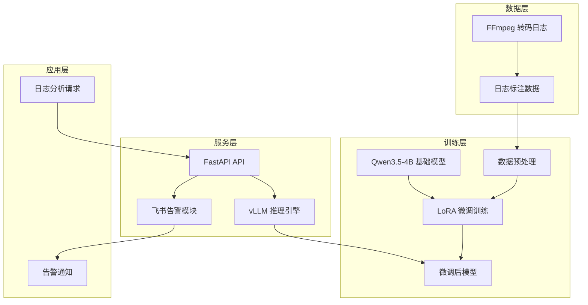

# LLM 微调实战项目：视频转码智能运维平台


## 项目概述

本项目是一个端到端的 LLM 微调实战课程配套代码，通过实战学习如何将开源大模型微调到特定领域。



## 技术栈

- **微调框架**: Unsloth 2026.5.2
- **推理引擎**: vLLM  0.20.1
- **API 框架**: FastAPI 0.136.1 
- **基础模型**: Qwen3.5 4B 


## 学习路径

```
Day 1: 数据准备与模型训练
├── 1.1 理解分析需求
├── 1.2 数据清洗与格式化
├── 1.3 模型训练

Day 2: 模型部署与服务
├── 2.1 vLLM 推理部署
├── 2.2 FastAPI 服务开发
├── 2.3 FFmpeg 日志捕获
├── 2.4 飞书告警集成
└── 2.5 完整服务测试
```

## 目录结构

```
fine-tuning-project1-v3/
├── day1/                    # 第一天：数据准备与模型训练
│   ├── 1-raw-data/          # 原始数据（FFmpeg 日志文件）
│   │   └── ffmpeg_logs/     # 转码日志及错误处理日志
│   ├── 2-prepare-data/      # 数据预处理
│   │   ├── prepare_dataset.py      # 数据集准备脚本
│   │   └── chat-template-analyzer.py # 对话模板侦测
│   └── 3-train/             # 模型训练
│       └── train.py         # LoRA 微调脚本
├── day2/                    # 第二天：模型部署与服务
│   ├── 1-validation/        # 模型验证
│   │   ├── 1-launch-vllm.sh
│   │   └── 2-curl-validation-succ.sh
│   ├── 2-fastapi/           # FastAPI 服务
│   │   ├── main.py
│   │   ├── lifespan1.py
│   │   └── lifespan2.py
│   ├── 3-ffmpeg/            # FFmpeg 日志捕获
│   │   ├── 4-capture-ffmpeg.py
│   │   └── 5-capture-ffmpeg-sendto-vllm.py
│   ├── 4-feishu/            # 飞书告警集成
│   │   ├── 1-send.py
│   │   └── 2-alert.py
│   └── 5-service/           # 完整服务整合
│       ├── service-v1.py    # 基础版本
│       ├── service-v2.py    # 优化版本
│       └── transcoder.py    # 测试验证脚本
└── README.md
```

## 课程结构

### Day 1 - 数据准备与模型训练

| 模块 | 路径 | 说明 |
|------|------|------|
| 原始数据 | [day1/1-raw-data](day1/1-raw-data) | FFmpeg 转码日志及标注数据 |
| 数据预处理 | [day1/2-prepare-data](day1/2-prepare-data) | 数据清洗与格式化 |
| 模型训练 | [day1/3-train](day1/3-train) | LoRA 微调脚本 |

### Day 2 - 模型部署与服务

| 模块 | 路径 | 说明 |
|------|------|------|
| 模型验证 | [day2/1-validation](day2/1-validation) | vLLM 推理服务验证 |
| FastAPI 服务 | [day2/2-fastapi](day2/2-fastapi) | API 服务开发 |
| FFmpeg 日志捕获 | [day2/3-ffmpeg](day2/3-ffmpeg) | 日志捕获与分析 |
| 飞书告警集成 | [day2/4-feishu](day2/4-feishu) | 告警通知集成 |
| 完整服务 | [day2/5-service](day2/5-service) | 完整服务整合 |


---

*本项目是微调课程的实战配套代码，建议配合课程视频学习。*
