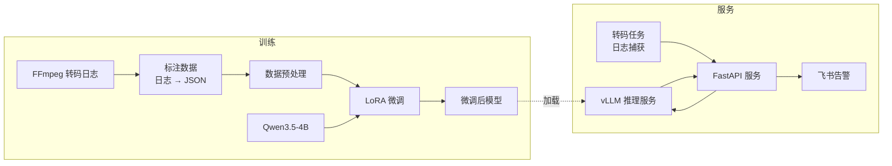

# FFmpeg Log Alert LLM：基于大模型微调的视频转码日志智能告警系统

面向视频转码运维场景，基于 Qwen3.5-4B 进行 LoRA 微调，让模型读取 FFmpeg 转码日志并输出结构化的 JSON 分析结果；使用 vLLM 部署推理服务，通过 FastAPI 封装业务接口，在检测到转码异常时自动推送飞书告警，实现从**日志捕获 → 智能分析 → 告警通知**的完整闭环。

## 背景

视频平台每天运行大量转码任务，FFmpeg 日志冗长、报错信息分散，人工排查效率低。传统的关键字规则难以覆盖各种错误形态，也很难给出可读的原因说明。本项目用微调后的大模型直接理解日志内容，输出机器可解析的 JSON，供下游服务判断是否告警。

## 系统架构



## 技术栈

| 环节 | 工具 |
|---|---|
| 基座模型 | Qwen3.5-4B |
| 微调 | Unsloth 2026.5.2，LoRA |
| 推理部署 | vLLM 0.20.1（OpenAI 兼容接口） |
| 服务 | FastAPI 0.136.1 |
| 告警 | 飞书机器人 Webhook |
| 硬件 | NVIDIA RTX 5090 32GB |

## 训练结果

| 项目 | 数据 |
|---|---|
| 训练数据 | 2925 条“转码日志 → JSON 分析结果”样本 |
| 方法 | LoRA，可训练参数约 0.93%，训练后合并为 16-bit 完整权重 |
| 配置 | 3 个 epoch，549 步，有效 batch 16 |
| 耗时 | RTX 5090 上约 208 分钟，峰值显存约 24GB |
| Loss | train_loss 0.195，训练末期约 0.07 |
| 验证 | 成功与失败两类测试日志均输出格式正确的 JSON |

## 服务压测

使用 ApacheBench 对 FastAPI 的同步与异步接口进行压测（10 万请求、1 万并发，均 0 失败）：

| 接口 | 吞吐量 | 总耗时 | P50 延迟 |
|---|---|---|---|
| 同步 `/sync` | 1040 req/s | 96.2 s | 9.6 s |
| 异步 `/async` | 1547 req/s（约 1.5 倍） | 64.6 s | 4.4 s |

## 工作流程

```
1-training  数据准备与模型训练
├── 原始日志收集：成功 / 失败的 FFmpeg 转码日志
├── 数据预处理：清洗日志，构造“日志 → JSON”训练样本，检查对话模板
└── LoRA 微调：训练并合并保存模型

2-serving  模型部署与服务
├── vLLM 部署：启动推理服务，用成功 / 失败日志验证输出
├── FastAPI：封装分析接口，管理服务生命周期
├── 日志捕获：运行 FFmpeg 转码并实时捕获日志，发送给模型分析
├── 飞书告警：异常时推送告警消息
└── 服务整合：串联完整流程并测试
```

## 目录结构

```
ffmpeg-log-alert-llm/
├── 1-training/                        # 数据准备与模型训练
│   ├── 1-raw-data/                    # 原始数据
│   │   └── ffmpeg_logs/               # 转码日志及错误日志
│   ├── 2-prepare-data/                # 数据预处理
│   │   ├── prepare_dataset.py         # 构造训练数据集
│   │   └── chat-template-analyzer.py  # 检查模型对话模板
│   └── 3-train/                       # 模型训练
│       └── train.py                   # LoRA 微调脚本
│
├── 2-serving/                         # 模型部署与服务
│   ├── 1-validation/                  # 推理服务验证
│   │   ├── 1-launch-vllm.sh           # 启动 vLLM
│   │   └── 2-curl-validation-succ.sh  # 用测试日志验证输出
│   ├── 2-fastapi/                     # FastAPI 服务
│   │   ├── main.py
│   │   ├── lifespan1.py               # 服务生命周期管理
│   │   └── lifespan2.py
│   ├── 3-ffmpeg/                      # FFmpeg 日志捕获
│   │   ├── 4-capture-ffmpeg.py
│   │   └── 5-capture-ffmpeg-sendto-vllm.py
│   ├── 4-feishu/                      # 飞书告警
│   │   ├── 1-send.py
│   │   └── 2-alert.py
│   └── 5-service/                     # 完整服务
│       ├── service-v1.py              # 基础版本
│       ├── service-v2.py              # 优化版本
│       └── transcoder.py              # 转码测试脚本
└── README.md
```

## 模块说明

| 模块 | 路径 | 说明 |
|---|---|---|
| 原始数据 | [1-training/1-raw-data](1-training/1-raw-data) | FFmpeg 转码日志及标注数据 |
| 数据预处理 | [1-training/2-prepare-data](1-training/2-prepare-data) | 数据清洗与训练样本构造 |
| 模型训练 | [1-training/3-train](1-training/3-train) | LoRA 微调 |
| 推理验证 | [2-serving/1-validation](2-serving/1-validation) | vLLM 部署与输出验证 |
| API 服务 | [2-serving/2-fastapi](2-serving/2-fastapi) | FastAPI 接口与生命周期管理 |
| 日志捕获 | [2-serving/3-ffmpeg](2-serving/3-ffmpeg) | 捕获转码日志并发送给模型 |
| 飞书告警 | [2-serving/4-feishu](2-serving/4-feishu) | 异常告警推送 |
| 完整服务 | [2-serving/5-service](2-serving/5-service) | 全流程整合 |

## 快速开始

```bash
# 1. 启动推理服务
cd 2-serving/1-validation
sh 1-launch-vllm.sh

# 2. 验证模型输出
sh 2-curl-validation-succ.sh

# 3. 启动完整服务（新开一个终端）
cd 2-serving/5-service
python service-v2.py
```

飞书告警需要先配置自己的机器人 Webhook 地址。

## 模型下载

微调后的模型已上传至 ModelScope：

https://www.modelscope.cn/models/JingweiYang/qwen35-4b-ffmpeglog-sft

## 已知问题与改进方向

- 训练数据覆盖的错误类型有限，遇到少见的报错可能判断不准，可以持续收集线上日志扩充数据集。
- 训练环境（transformers 5.x）保存的分词器配置与 vLLM 环境（transformers 4.x）不兼容，部署前需要把 `tokenizer_class` 改为 `Qwen2Tokenizer`。
- 目前只评估了少量测试日志，后续可以建立固定的测试集，统计 JSON 格式正确率和错误类型判断准确率。